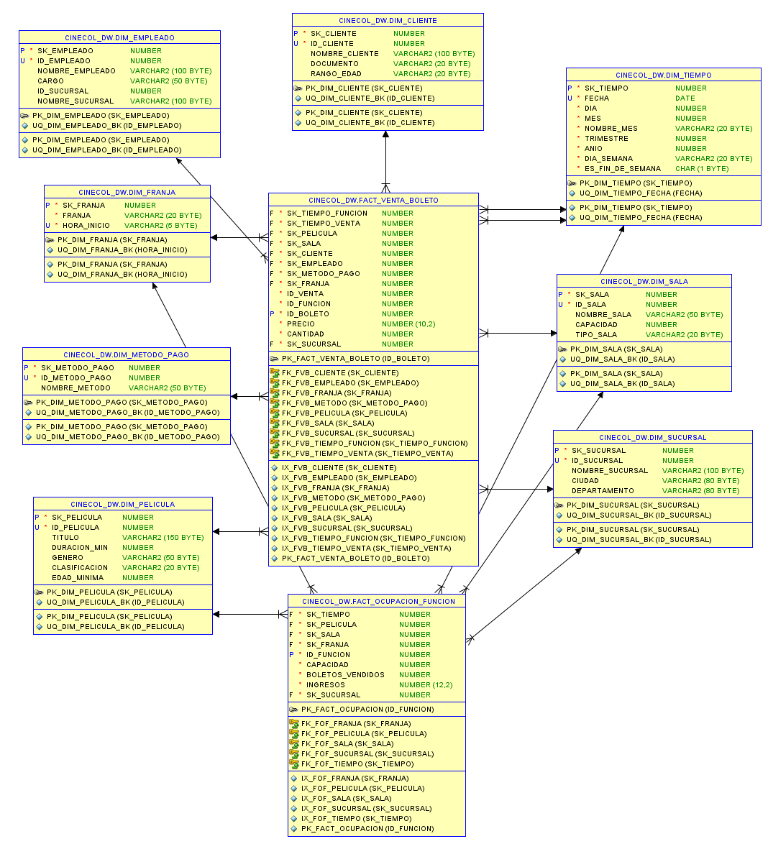

# Sistema de Información y Gestión Transaccional de CineCol

**Rafael Esteban Lozano Vargas**
**Cesar Ricardo Caro Sanchez**

{rafael.lozano05, cesar.caro}@uptc.edu.co

**Escuela de Ingeniería de Sistemas y Computación**
**Universidad Pedagógica y Tecnológica de Colombia (UPTC)**
**Facultad Seccional Sogamoso**

**2026**

**Asignatura:** Bases de Datos II (Grupo 60)
**Docente:** Ing. Mónica Katherine Durán Vaca

---

# Etapa 2: Carga y explotación analítica del Data Warehouse CineCol

## 1. Introducción

CineCol necesita analizar sus ventas de boletos por fecha, sucursal,
película, cliente, sala y método de pago. Para solucionar esta necesidad se
implementó un Data Warehouse en Oracle usando un modelo dimensional estrella.

El proceso de negocio seleccionado es la **venta de boletos**.

## 2. Objetivos

- Implementar el modelo estrella en Oracle.
- Cargar las dimensiones y las tablas de hechos.
- Validar que la información del OLTP y del DW coincida.
- Crear consultas SQL para responder preguntas de negocio.

## 3. Modelo dimensional

El modelo tiene dos tablas de hechos:

### FACT_VENTA_BOLETO

Su nivel de detalle es **una fila por boleto vendido**.

Contiene:

- Fechas de función y venta.
- Película.
- Sala.
- Sucursal.
- Cliente.
- Empleado.
- Método de pago.
- Franja horaria.
- Precio.
- Cantidad.

### FACT_OCUPACION_FUNCION

Su nivel de detalle es **una fila por función**.

Contiene:

- Película.
- Sala.
- Sucursal.
- Fecha.
- Franja horaria.
- Capacidad.
- Boletos vendidos.
- Ingresos.

La ocupación se calcula en las consultas con:

```text
boletos_vendidos / capacidad * 100
```

No se almacena como una medida fija porque es un porcentaje calculado.

## 4. Dimensiones

El modelo contiene las siguientes dimensiones:

- `DIM_TIEMPO`: fecha, día, mes, trimestre, año y fin de semana.
- `DIM_SUCURSAL`: sucursal, ciudad y departamento.
- `DIM_PELICULA`: título, duración, género y clasificación.
- `DIM_CLIENTE`: cliente, documento y rango de edad.
- `DIM_SALA`: sala, capacidad y tipo de sala.
- `DIM_METODO_PAGO`: método utilizado en la compra.
- `DIM_FRANJA`: tarde, noche o madrugada.
- `DIM_EMPLEADO`: empleado, cargo y sucursal.

`DIM_SUCURSAL` se mantiene separada de `DIM_SALA`. Una sucursal puede tener
varias salas, por lo que esta separación facilita el análisis por ciudad,
departamento y sucursal.

Cada dimensión tiene:

- Una llave sustituta (`SK`).
- La llave original del OLTP como business key.
- Una fila `No definido` con `SK = -1`.

Las dimensiones utilizan SCD tipo 1 porque el proyecto representa una foto
del periodo analizado y no necesita conservar versiones históricas.

## 5. Diagrama del modelo estrella

El diagrama generado en Oracle SQL Developer Data Modeler se incluye a
continuación:



El diagrama debe mostrar las dos tablas de hechos, las dimensiones, las
llaves primarias, las llaves foráneas y las relaciones.

## 6. Implementación en Oracle

El usuario `CINECOL_DW` se creó en Oracle con permisos para consultar las
tablas del esquema OLTP `CINECOL_R`.

El esquema DW contiene:

- Tablas de dimensiones.
- Tablas de hechos.
- Secuencias para las llaves sustitutas.
- Restricciones de integridad.
- Llaves foráneas.
- Índices sobre las llaves de las tablas de hechos.
- Tabla `ETL_RECHAZO_BOLETO` para registrar filas con problemas.

## 7. Proceso ETL

La carga se ejecutó en este orden:

1. `DIM_TIEMPO`.
2. `DIM_PELICULA`.
3. `DIM_SALA`.
4. `DIM_SUCURSAL`.
5. `DIM_CLIENTE`.
6. `DIM_EMPLEADO`.
7. `DIM_METODO_PAGO`.
8. `DIM_FRANJA`.
9. `FACT_VENTA_BOLETO`.
10. `FACT_OCUPACION_FUNCION`.

Las dimensiones se cargan con `MERGE`, lo que permite actualizar o insertar
sin duplicar las business keys.

Las tablas de hechos se cargan con `TRUNCATE` y luego se vuelven a cargar
completamente. Esta decisión es adecuada para este proyecto porque se trabaja
con una fotografía del periodo y permite repetir la carga de forma sencilla.

## 8. Resultados de la carga

| Tabla | Filas |
|---|---:|
| `DIM_TIEMPO` | 184 |
| `DIM_PELICULA` | 15 |
| `DIM_SALA` | 30 |
| `DIM_SUCURSAL` | 19 |
| `DIM_CLIENTE` | 30 |
| `DIM_EMPLEADO` | 39 |
| `DIM_METODO_PAGO` | 6 |
| `DIM_FRANJA` | 6 |
| `FACT_VENTA_BOLETO` | 12.774 |
| `FACT_OCUPACION_FUNCION` | 2.876 |
| `ETL_RECHAZO_BOLETO` | 0 |

El archivo de datos contiene 60 clientes y 60 películas. Sin embargo, en la
instancia Oracle usada para esta ejecución se cargaron y utilizaron 30
clientes con compras y 15 películas con funciones.

Por esta razón, la meta de 30 o más películas con funciones no se alcanzó.
Esto limita el análisis `Top 5 por género`, porque existen 15 películas
distribuidas entre 7 géneros y la mayoría de los géneros no tiene cinco
películas para comparar.

## 9. Validación de integridad

La auditoría del OLTP devolvió cero filas en todos los controles:

- Total de venta igual a la suma de sus boletos.
- Empleado y venta pertenecen a la misma sucursal.
- Función y venta pertenecen a la misma sucursal.
- El asiento pertenece a la sala de la función.
- La venta ocurre antes de la función.
- El cliente cumple la edad de la clasificación.
- No existen funciones solapadas en una misma sala.

La reconciliación entre OLTP y DW produjo:

| Control | Resultado |
|---|---:|
| Boletos en OLTP | 12.774 |
| Boletos en DW | 12.774 |
| Funciones en OLTP | 2.876 |
| Funciones en DW | 2.876 |
| Ingresos de boletos en OLTP | 275.676.000 |
| Ingresos de boletos en DW | 275.676.000 |
| Diferencia de boletos | 0 |
| Diferencia de ingresos | 0 |
| Diferencia de ventas | 0 |
| Diferencia de funciones | 0 |
| Filas con `SK = -1` | 0 |
| Rechazos ETL | 0 |
| Sucursales en `DIM_SUCURSAL` | 19 |

También se revisaron tres boletos desde la tabla OLTP hasta la fact y sus
dimensiones relacionadas.

## 10. Consultas analíticas

El archivo `consultas_dw.sql` contiene consultas para responder:

1. Ingresos por sucursal y mes.
2. Películas más vistas por género.
3. Ingresos por franja horaria y día de la semana.
4. Ocupación por sala y tipo de sala.
5. Ingresos y participación por método de pago.
6. Crecimiento de ingresos mes a mes.
7. Ingresos acumulados por sucursal.
8. Subtotales por departamento, ciudad y sucursal.
9. Perfil de clientes por rango de edad y género.
10. Empleados con más ventas y ticket promedio.

También incluye:

- Tres consultas equivalentes sobre el OLTP.
- Dos planes de ejecución con `EXPLAIN PLAN`.

Estas consultas permiten responder las preguntas principales de CineCol:

- ¿Cuál es la película más vista?
- ¿Qué sucursal genera mayores ingresos?
- ¿Qué días tienen mayor afluencia?
- ¿Qué género tiene mayor aceptación?
- ¿Qué horarios tienen mayor ocupación?
- ¿Cuál es el ingreso mensual por sucursal?
- ¿Qué clientes realizan más compras?

## 11. Archivos entregados

### Archivos del OLTP

- [`cinecol_ddl.sql`](../Oracle/cinecol_ddl.sql)
- [`cinecol_datos.sql`](../Oracle/cinecol_datos.sql)
- [`auditoria_oltp.sql`](../Oracle/auditoria_oltp.sql)
- [`paso_2_estructura_oltp.sql`](../Oracle/paso_2_estructura_oltp.sql)
- [`paso_3_correccion_datos.sql`](../Oracle/paso_3_correccion_datos.sql)
- [`paso_4_generar_volumen.sql`](../Oracle/paso_4_generar_volumen.sql)
- [`paso_4_corregir_edades.sql`](../Oracle/paso_4_corregir_edades.sql)

### Archivos del DW

- [`paso_5_crear_usuario_dw.sql`](../Oracle/paso_5_crear_usuario_dw.sql)
- [`dw_ddl.sql`](../Oracle/dw_ddl.sql)
- [`paso_6_separar_dim_sucursal.sql`](../Oracle/paso_6_separar_dim_sucursal.sql)
- [`etl_cinecol_dw.sql`](../Oracle/etl_cinecol_dw.sql)
- [`validacion_dw.sql`](../Oracle/validacion_dw.sql)
- [`consultas_dw.sql`](../Oracle/consultas_dw.sql)

## 12. Conclusión

Se implementó y cargó en Oracle un Data Warehouse con modelo estrella para
analizar la venta de boletos de CineCol.

La información fue validada porque los conteos y los ingresos del OLTP y del
DW coinciden. Además, no se encontraron rechazos ETL, llaves desconocidas ni
duplicados en las business keys.

El modelo permite analizar ventas, ingresos, ocupación, películas, clientes,
sucursales, salas y métodos de pago mediante consultas SQL.
