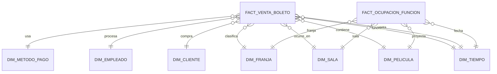

# Informe DW estrella CineCol

## 1. Objetivo

Construir un almacén de datos dimensional para analizar la venta de boletos,
con una fila por boleto en `FACT_VENTA_BOLETO` y una fila por función en
`FACT_OCUPACION_FUNCION`.

## 2. Preparación del OLTP

La auditoría inicial devolvió cero filas en los siete controles de consistencia:

- Total de venta contra suma de boletos.
- Sucursal del empleado contra sucursal de venta.
- Sucursal de la función contra sucursal de venta.
- Pertenencia del asiento a la sala.
- Venta anterior a la función.
- Edad mínima de la clasificación.
- Solapamiento de funciones.

Se agregaron las restricciones únicas de boleto, cliente y asiento, además de
`inicio_ts` y `fin_ts` en `funcion`. Las funciones que cruzan medianoche se
calculan avanzando un día en `fin_ts`.

## 3. Ampliación de datos

El generador produjo:

| Indicador | Resultado |
|---|---:|
| Funciones agosto-octubre | 2.876 |
| Ventas | 2.620 |
| Boletos | 12.774 |
| Sucursales con ventas | 19 |
| Clientes con compras | 30 |

La base de origen disponible contiene 30 clientes; por ello no se alcanzó la
meta opcional de 60 clientes.

La reauditoría posterior devolvió cero filas en todos los controles.

## 4. Diseño dimensional

Se eligió un esquema estrella puro con dimensiones desnormalizadas y llaves
sustitutas. Todas las dimensiones aplican SCD tipo 1 porque el alcance es una
foto del periodo académico y no requiere conservar historial de cambios.

Cada dimensión tiene una fila `No definido` con `SK = -1`. Las facts tienen
índices sobre todas sus llaves foráneas.

## 5. Carga ETL

La carga se ejecutó en este orden:

1. `DIM_TIEMPO`.
2. Dimensiones de película, sala, cliente, empleado, método de pago y franja.
3. `FACT_VENTA_BOLETO`.
4. `FACT_OCUPACION_FUNCION`.

Las dimensiones utilizan `MERGE` por business key. Las facts usan `TRUNCATE`
y recarga completa porque el proyecto trabaja con una foto del periodo y esta
estrategia hace la carga repetible.

Resultado de la carga:

| Tabla | Filas |
|---|---:|
| `DIM_TIEMPO` | 184 |
| `DIM_PELICULA` | 15 |
| `DIM_SALA` | 30 |
| `DIM_CLIENTE` | 30 |
| `DIM_EMPLEADO` | 39 |
| `DIM_METODO_PAGO` | 6 |
| `DIM_FRANJA` | 6 |
| `ETL_RECHAZO_BOLETO` | 0 |
| `FACT_VENTA_BOLETO` | 12.774 |
| `FACT_OCUPACION_FUNCION` | 2.876 |

## 6. Reconciliación

La validación OLTP contra DW confirmó:

| Control | Resultado |
|---|---:|
| Boletos OLTP | 12.774 |
| Boletos DW | 12.774 |
| Funciones OLTP | 2.876 |
| Funciones DW | 2.876 |
| Ingresos de boletos OLTP | 275.676.000 |
| Ingresos de boletos DW | 275.676.000 |
| Total de ventas OLTP | 275.676.000 |
| Diferencia de boletos | 0 |
| Diferencia de ingresos | 0 |
| Diferencia de funciones | 0 |
| Filas con `SK = -1` | 0 |
| Rechazos ETL | 0 |
| Duplicados en business keys | 0 |

La trazabilidad de tres boletos confirmó el recorrido desde la fact hasta las
dimensiones de tiempo, película, sala, cliente, empleado, método y franja.

## 7. Consultas analíticas

Las diez preguntas de negocio están en [consultas_dw.sql](./consultas_dw.sql).
El script también contiene tres contrastes equivalentes sobre el OLTP y dos
sentencias `EXPLAIN PLAN`.

| # | Análisis | Técnica |
|---:|---|---|
| 1 | Ingresos por sucursal y mes | Agrupación multidimensional |
| 2 | Top 5 películas por género | `RANK` |
| 3 | Ingresos por franja y día | Agrupación dimensional |
| 4 | Ocupación por sala y tipo | Ratio de medidas |
| 5 | Participación por método de pago | `RATIO_TO_REPORT` |
| 6 | Crecimiento mensual | `LAG` |
| 7 | Acumulado por sucursal | Función analítica `SUM` |
| 8 | Subtotales geográficos | `ROLLUP` y `GROUPING` |
| 9 | Perfil de público | `CUBE` |
| 10 | Desempeño de empleados | `DENSE_RANK` y promedio |

El fragmento ejecutado de la consulta 7 mostró acumulados progresivos por
sucursal y fecha, confirmando el funcionamiento de la ventana analítica.

## 8. Scripts entregados

- [auditoria_oltp.sql](./auditoria_oltp.sql)
- [paso_2_estructura_oltp.sql](./paso_2_estructura_oltp.sql)
- [paso_3_correccion_datos.sql](./paso_3_correccion_datos.sql)
- [paso_4_generar_volumen.sql](./paso_4_generar_volumen.sql)
- [paso_5_crear_usuario_dw.sql](./paso_5_crear_usuario_dw.sql)
- [dw_ddl.sql](./dw_ddl.sql)
- [etl_cinecol_dw.sql](./etl_cinecol_dw.sql)
- [validacion_dw.sql](./validacion_dw.sql)
- [consultas_dw.sql](./consultas_dw.sql)
